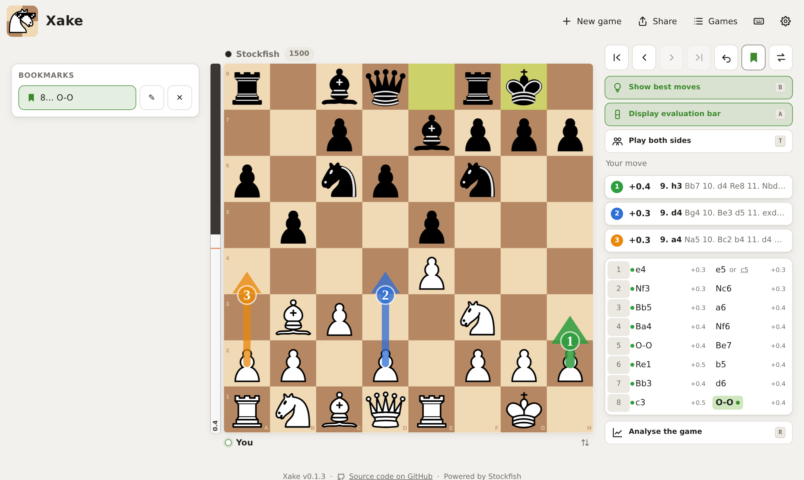
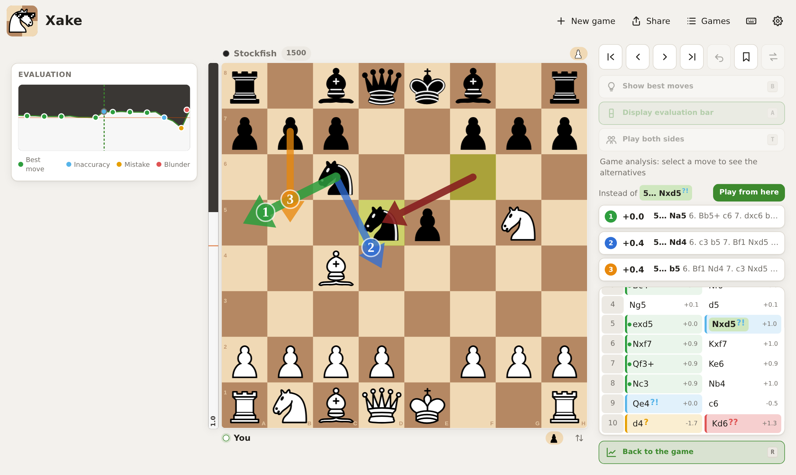
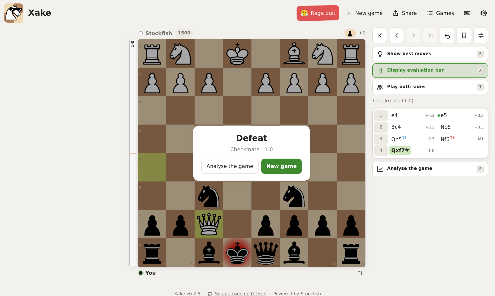
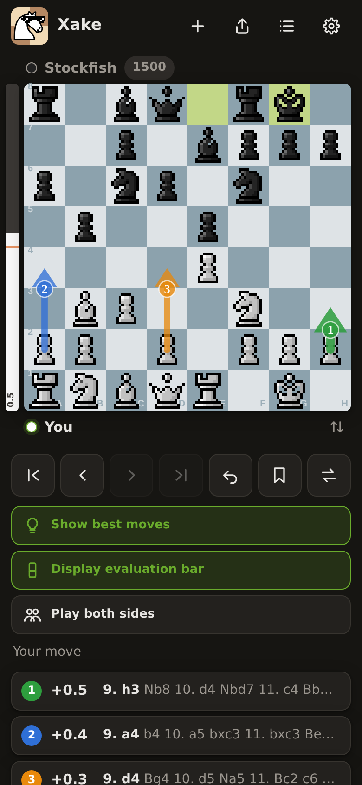
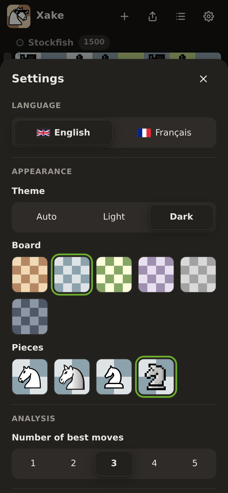
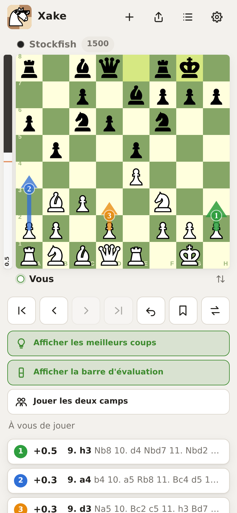

[](https://github.com/essembeh/xake/actions/workflows/release.yml)

# Xake

> **TL;DR** Play Stockfish at the Elo you choose, peek at the best moves when you want, and
> replay your games with an evaluation graph that points at your mistakes. Runs in the browser,
> installs on a phone home screen, stores nothing on the server.

_Xake_ means "chess" in Basque.

## 🚀 Try the demo

**https://xake.onrender.com**

No sign-up, no account: open the page and play.

> This demo is a public instance hosted on [Render](https://render.com/). Stockfish runs on your own
> device, so it does not slow down when others play. It comes without any guarantee and can be
> limited or stopped at any time. To keep a game safe, export it as PGN or
> [install your own](#install).

## 🔒 Privacy

- **No sign-up, no account, no login.**
- **Your games live in your browser** (`localStorage`), on your device only: the server has no
  database and stores nothing. Clearing the site data deletes them, export a PGN to keep one.
- **No cookies, no analytics, no tracking, no third-party request**: every file is served by the
  instance itself.
- **Stockfish runs on your device**: the server never sees your moves, it only serves the app.
  Shared links carry the game after the `#`, a part of the URL browsers never send to the server.
- Like any web server, the host may keep standard access logs (IP address, requested URL).



## Features

- **Opponent at any level**, chosen for each new game: Stockfish from 400 to 3190 Elo, or Maia
  from 1100 to 1900, a network trained on human games that plays like a player of that level.
- **Best moves on demand** (`B`, or hold a right click / long press on the board): up to 5
  Stockfish lines, numbered and colour-coded arrows on the board, the same numbers in the list;
  tap a line to play it.
- **Evaluation bar** next to the board (`A`), with inaccuracies `?!`, mistakes `?` and blunders
  `??` marked in the move list; the **captured pieces** and the material balance next to each player.
- **Game analysis** (`R`): an evaluation graph of the whole game, the judged moves highlighted, and
  for each move, yours or Stockfish's, the best moves that could have been played instead.
  **Replay this move** takes you back just before one of your moves; a tap on an alternative, in
  the list or on its arrow, plays it instead, yours or Stockfish's; **Back to the game** returns to the last move.
- **Variations**: go back anywhere and play another move, nothing is lost; the move list shows the
  line you browse, each move lists its alternatives (`e6 or Bf5`), a tap switches to one.
- **Bookmarks** (`M`) to jump back to a position and try another idea.
- **Take back** (`U`) with redo, **swap sides with Stockfish** (`C`) or **play both sides** (`T`)
  to force the opponent move and study a precise position.
- **Saved games** in the browser, **PGN** export / import, and **shareable links**: the whole game,
  variations included, fits in the URL.
- **Keyboard shortcuts** for everything (`?` lists them).
- **Themes**: light / dark / auto, 6 boards, 4 piece sets, all under free licences; **English and French**, following the browser language.
- **Sounds** for moves, captures, checks and the end of the game, can be muted in the settings.
- **Rage quit** 😤 (can be turned off in the settings): shows up when the evaluation turns against
  you, to start over and forget the game. Calm, then orange, then red and shaking as your position gets worse.
- **Mobile first**: touch friendly layout, installable on the iOS / Android home screen (PWA).
- **Stockfish runs on your device** (WebAssembly): the installed app plays and analyses offline,
  about 1 s per analysis on a recent phone.

| Game analysis | Game over |
| --- | --- |
|  |  |

| Mobile, dark theme | Settings | In French |
| --- | --- | --- |
|  |  |  |

## How it works

Stockfish runs in the player's browser: [stockfish.js](https://github.com/nmrugg/stockfish.js), the
lite WebAssembly build (1.8 MB), in Web Workers. The backend is a small
[FastAPI](https://fastapi.tiangolo.com/) service that only serves the app and its settings; the
games live in the browser (`localStorage`) and the installed app plays offline. The front-end is
plain JavaScript modules without any build step, with
[chessground](https://github.com/lichess-org/chessground) (the Lichess board) and
[chess.js](https://github.com/jhlywa/chess.js).

- The opponent is picked at each new game. Stockfish plays with `UCI_LimitStrength` / `UCI_Elo`
  (1320+), a node-starved engine below; the Elo is indicative, Stockfish calibrates it on long games.
  [Maia](https://github.com/CSSLab/maia-chess) is a network trained on Lichess games, one per 100
  points from 1100 to 1900, run by [ONNX Runtime Web](https://onnxruntime.ai/); its move is drawn
  among the human moves at least 10% likely. The network (3.5 MB, plus 15 MB for the runtime once)
  is downloaded when the game starts.
- Best moves and the evaluation bar search a fixed 1 million nodes (about 1 s on a recent phone),
  so the same answer on every browser, capped at 2 s on slow devices; the evaluation graph uses
  300,000 nodes per position.

Design notes live in [`docs/specs`](docs/specs).

# Install

## Helm

```sh
$ helm repo add xake https://essembeh.github.io/xake/
$ helm install xake xake/xake --set xake.defaultLanguage=en
```

Values are documented in the [chart README](charts/xake/README.md). The pod is a small static
server: the players' devices do the computing. Serve it over HTTPS, the service worker needs it.

## Docker

```sh
$ docker run --rm -p 8000:8000 ghcr.io/essembeh/xake:main
```

Then open http://localhost:8000/.

## From source

```sh
$ git clone https://github.com/essembeh/xake
$ cd xake
$ nix-shell     # or install uv and just yourself
$ uv sync
$ just webapp   # http://localhost:8000, also reachable from your LAN
```

## Configuration

| Variable | Default | Description |
| --- | --- | --- |
| `XAKE_DEFAULT_ELO` | `1500` | Stockfish level (400 to 3190) of a first visit, then each browser remembers the last level chosen |
| `XAKE_DEFAULT_LANGUAGE` | `en` | UI language (`en`, `fr`) for browsers in another language, until a user picks one in the settings |
| `XAKE_PLAY_MOVETIME_MS` | `300` | Thinking time of the opponent, in the player's browser |

# Development

```sh
$ just check        # ruff format + ruff check + mypy (CI: python-check)
$ just test         # pytest (CI: python-test)
$ just chart        # helm lint + template (CI: helm-lint)
$ just docker       # build and run the image with podman
$ just screenshots  # regenerate the README screenshots from a running `just webapp`
$ just vendor       # refresh the pinned front-end libraries and piece sets
```

# Libraries and assets

Every dependency and bundled asset is under a free licence compatible with the GPLv3.

| Component | Used for | Licence |
| --- | --- | --- |
| [Stockfish](https://stockfishchess.org/) via [stockfish.js](https://github.com/nmrugg/stockfish.js) | chess engine in WebAssembly, opponent and analysis (vendored) | GPL-3.0 |
| [Maia](https://github.com/CSSLab/maia-chess) networks, [ONNX conversion](https://huggingface.co/cstr/maia-chess-onnx-opset15) | human-like opponent (fetched at build) | GPL-3.0 |
| [ONNX Runtime Web](https://onnxruntime.ai/) | runs Maia in WebAssembly (fetched at build) | MIT |
| [FastAPI](https://fastapi.tiangolo.com/) / [Starlette](https://www.starlette.io/) | static files, settings, probes | MIT / BSD-3-Clause |
| [Uvicorn](https://www.uvicorn.org/) | ASGI server | BSD-3-Clause |
| [Pydantic](https://docs.pydantic.dev/) / [pydantic-settings](https://github.com/pydantic/pydantic-settings) | `XAKE_*` settings | MIT |
| [Loguru](https://github.com/Delgan/loguru) | logging | MIT |
| [chessground](https://github.com/lichess-org/chessground) | board (vendored) | GPL-3.0 |
| [chess.js](https://github.com/jhlywa/chess.js) | rules, SAN, PGN in the browser (vendored) | BSD-2-Clause |
| [Lichess](https://github.com/lichess-org/lila) piece sets | `cburnett`, `merida` / `mpchess` / `pixel` (vendored) | GPLv2+ / GPLv3+ / AGPLv3+ |

The Maia networks and ONNX Runtime (~46 MB) are not committed: [`scripts/fetch-maia.sh`](scripts/fetch-maia.sh)
fetches them with pinned SHA-256 sums, from `just webapp` and from the image build.
Front-end assets are pinned and fetched by [`scripts/vendor.sh`](scripts/vendor.sh), with the
lila [`COPYING.md`](src/xake/static/vendor/pieces/COPYING.md) that lists their authors and licences.
Several Lichess piece sets are not free and are left out. The boards are plain CSS colours and the
sounds are synthesized in the browser (WebAudio), no audio file is bundled.

# License

Xake is released under the [GPL-3.0-or-later](LICENSE), like chessground and Stockfish. The
AGPLv3+ `pixel` piece set keeps its own licence, as allowed by section 13 of the GPLv3.
